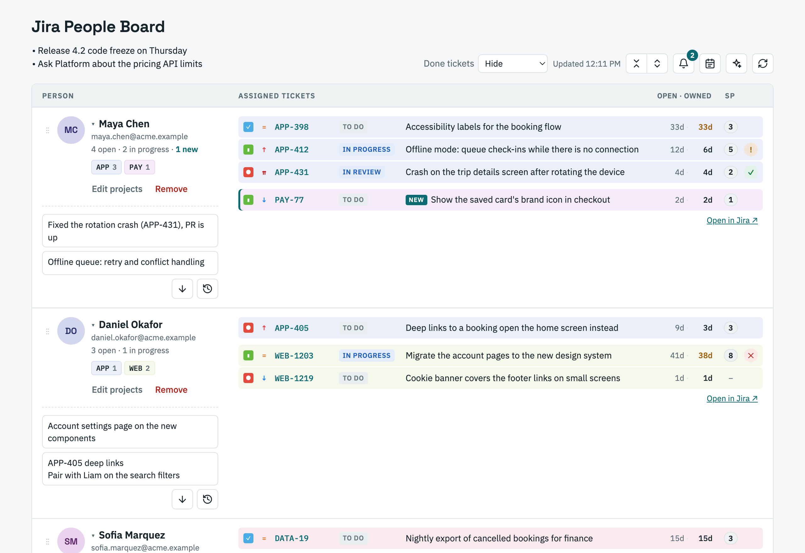
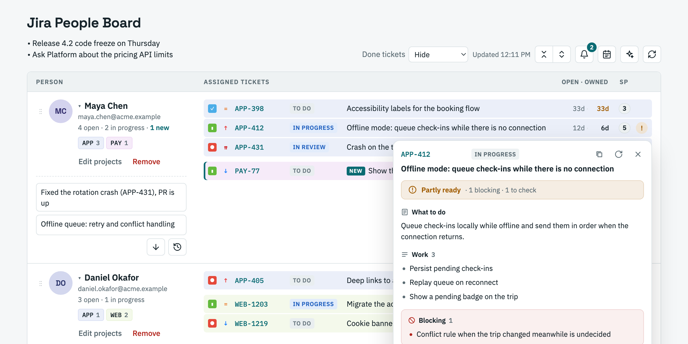
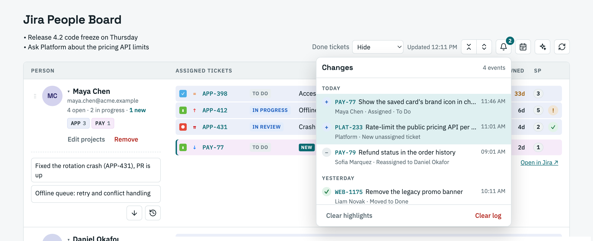
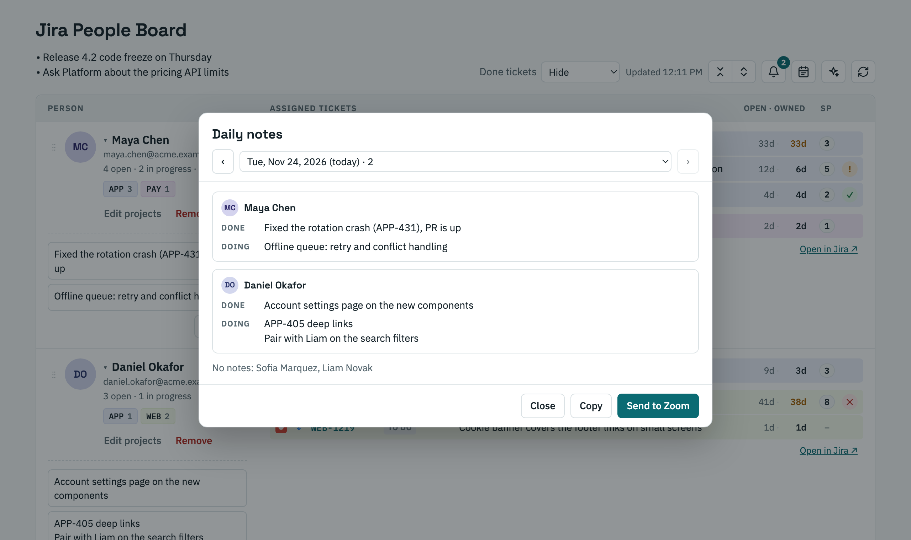
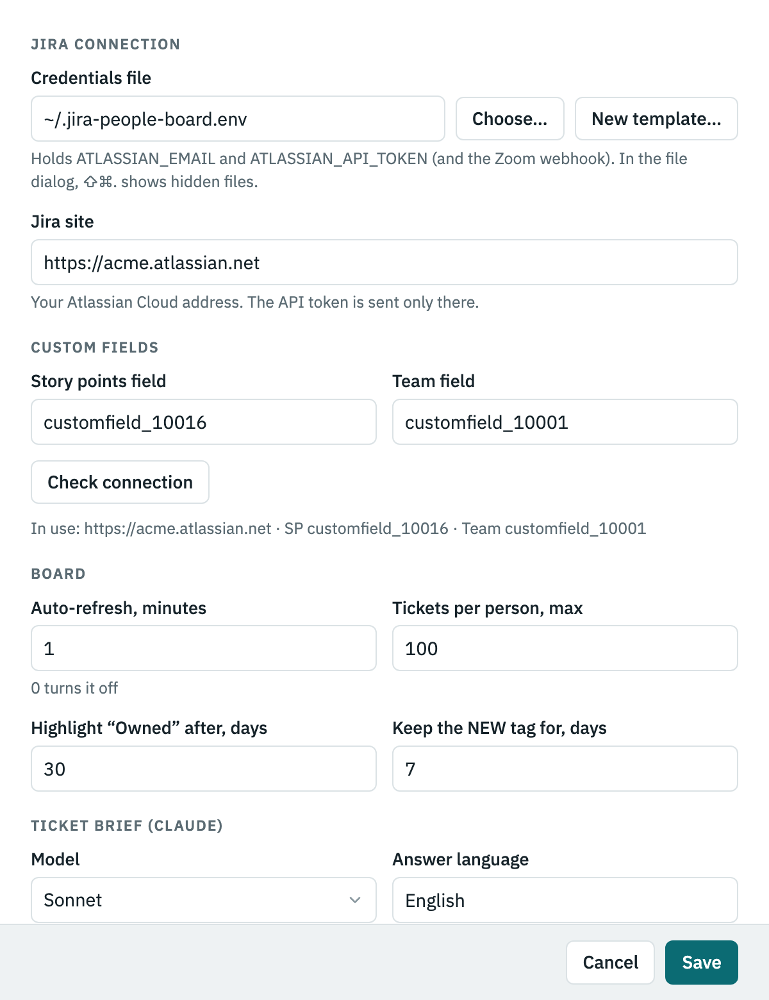

# Jira People Board



One screen with what everyone on the team is working on, for leads who'd rather not click through Jira filters.

- **A row per person**: their open tickets in the projects you pick, with status, priority, story points and age.
- **Teams too**: a row for a Jira team shows its tickets that nobody has picked up yet.
- **Open · Owned**: how long a ticket has been open, and how long it has been on this person. Ones that sat too long turn amber.
- **What changed**: new tickets are marked NEW, and the 🔔 log says why a ticket left a row (done, reassigned, moved).
- **Daily notes**: Done / Doing per person for the stand-up, with history. You can copy them, or post them to a Zoom channel.
- **Ticket brief**: Claude reads a ticket with its parent, links and comments, then says what to do and whether it's ready for development.
- **No server**: a desktop app that talks to Jira with your own API token. The token stays in the backend and never reaches the page.

## Ticket brief

Click the ✦ at the end of a row (or in the header, for any key). The verdict stays on the row: ✓ ready, ! partly ready, ✕ not ready.



It runs `claude -p` through Claude Code with your Claude subscription, so no API key is needed. Claude gets no tools, only the ticket text. Answers are cached until the ticket, model, language or prompt changes. The model, answer language and prompt can be changed in Settings.

## Changes and daily notes





## Use

- **+ Add person or team**: find them in Jira, then pick projects (none = every project).
- **Click a name** to fold the row to one line. **⋮⋮** drags it (or focus it and press ↑ / ↓).
- **Project chips** under a person filter their tickets.
- **Done tickets** in the header shows the ones finished in the last 7–30 days.
- In the Done / Doing fields, **⌘↩** saves and moves to the next person.
- The board refreshes every minute while it's in front.



## Install

> [!WARNING]
> **macOS only.** It's a Tauri app and may build elsewhere, but it has only ever been built and used on macOS.

You need a Jira Cloud account with an [API token](https://id.atlassian.com/manage-profile/security/api-tokens). For ticket briefs you also need [Claude Code](https://code.claude.com/docs/en/overview), installed and signed in.

To build from source you also need [Node.js](https://nodejs.org/), [Rust](https://www.rust-lang.org/tools/install) and the Xcode Command Line Tools (see the [Tauri prerequisites](https://tauri.app/start/prerequisites/)).

```bash
npm install
```

```bash
npm run install:mac
```

On first start, open **Settings… (⌘,)** and use **New template…** to create the credentials file, then fill it in:

```bash
ATLASSIAN_EMAIL=you@company.com
ATLASSIAN_API_TOKEN=…
# optional, for Send to Zoom (Team Chat → Apps → Incoming Webhook)
ZOOM_WEBHOOK_URL=https://integrations.zoom.us/chat/webhooks/incomingwebhook/…
ZOOM_WEBHOOK_TOKEN=…
```

Then set your Jira site and the story points / team field ids, and press **Check connection**.

## Develop

- `npm run dev`: the app with hot reload. It's a separate "Dev" build with its own data.
- `npm test`: the Rust unit tests. `npm run lint` also runs clippy (`rustup component add clippy`).
- `npm run demo`: the real page on made-up data in the browser, at http://127.0.0.1:4318/demo/ (no Jira needed).
- `npm run screenshots`: retakes `docs/screenshots` from the demo with headless Chrome.
- `scripts/migrate-dev-to-prod.sh`: copies the Dev build's people, notes, settings and briefs into the installed app (`--dry-run` first). Quit both apps before running it.

Code: `src-tauri/src` is the backend (Jira, storage, briefs, Zoom), and `public/` is the page (plain ES modules, no build step).

## License

MIT, see [LICENSE](LICENSE).
